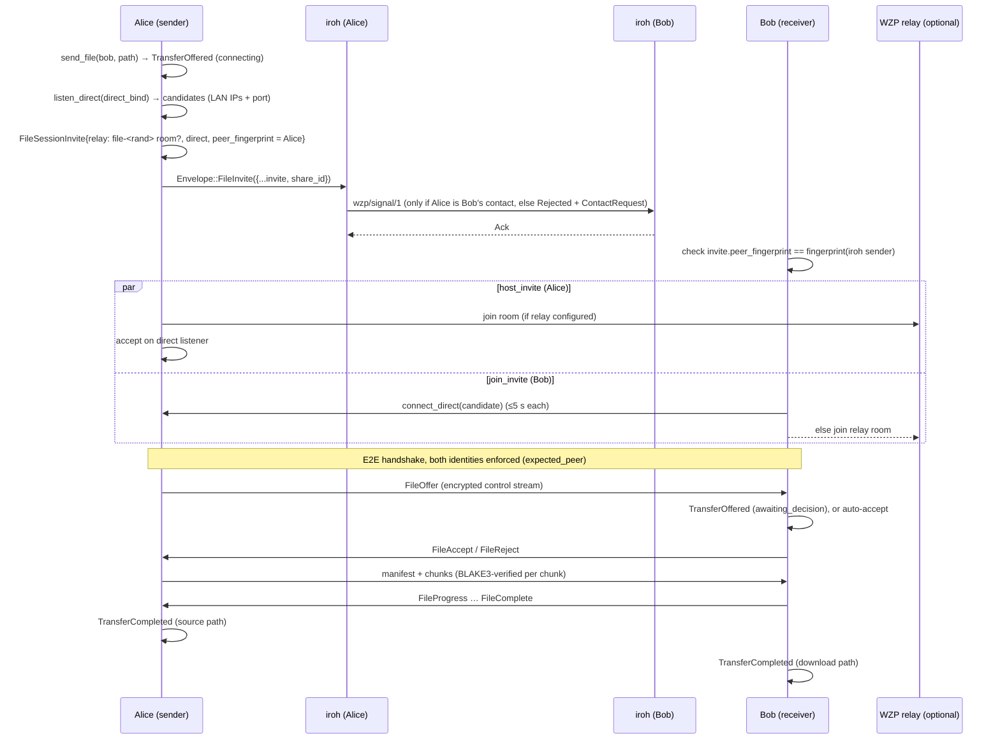

# wzp-share: send a file to a contact

`crates/wzp-share` is the headless, app-level glue between

* **wzp-iroh** (identity, contacts, presence, signaling; see `docs/IROH.md`), and
* **wzp-files** (E2E-encrypted, resumable file sessions over WZP QUIC; see
  `docs/FILE-TRANSFER.md`).

The Tauri layer (or the `wzp-share` CLI) only calls `ShareNode` and forwards
`ShareEvent`s to the UI. iroh carries only the small invite. File bytes go
over a WZP session, either direct or through the user's WZP relay.

## Flow



The same steps in plain text:

```
sender                              iroh                     receiver
------                              ----                     --------
send_file ─▶ listener + invite ──FileInvite──▶ known contact? ── no ─▶ Rejected (+ContactRequest)
                                                 │ yes
                                                 ▼
                                   fingerprint(invite) == iroh sender? ── no ─▶ InviteRefused
                                                 │ yes
host_invite (direct ∥ relay) ◀──── join_invite (direct candidates, then relay)
FileEndpoint::send ──── FileOffer ─────────────▶ TransferOffered ─▶ accept()/reject()
       ◀────────────── FileAccept / FileReject ─┘
chunks ──────────────────────────────────────▶ verify + write
TransferCompleted ◀──── FileComplete ─────────── TransferCompleted
```

## Design notes

* **One WZP session per transfer.** Each `send_file` binds its own direct
  listener (`direct_bind`, default `0.0.0.0:0`) and, when a relay is
  configured, a fresh random `file-<32 hex>` room. The session is closed when
  the transfer ends. There is no session reuse yet.
* **Direct candidates.** If the listener is bound to a specific IP, that
  address is the only candidate. If it is bound to `0.0.0.0`, the candidates
  are the local interface IPv4 addresses that iroh discovered, with the
  listener's port (at most 8). A public server-reflexive address is **not**
  included yet: it would need STUN or relay-Reflect run from the listener's
  own UDP socket, and wzp-files' `DirectListener` doesn't expose that.
  Behind NAT, the relay fallback covers this case.
* **Identity checks happen at three layers.** iroh delivers `FileInvite` only
  from contacts in the book, authenticated by the TLS key. The receiver
  requires `invite.peer_fingerprint` to equal the WZP fingerprint of that
  iroh sender, because `EndpointId` is the same key as the WZP identity. Both
  wzp-files handshakes then enforce `expected_peer`: the sender expects the
  contact, and the receiver expects the inviter. A stranger who learns the
  relay room therefore can't hijack the session.
* **Consent.** The receiver joins the session before asking, because it needs
  the `FileOffer` for the name and size. Nothing is written to disk until
  `accept`. `auto_accept` exists for headless use.
* **Ids.** `ShareId` (16 random bytes, hex in JSON) is created by the sender
  and carried in the invite, so both sides use the same id. It is separate
  from the wzp-files `TransferId`.
* **Limits.** At most `max_incoming_sessions` (8) invites can be connecting
  or awaiting a decision at once. More are refused with `InviteRefused`. The
  wzp-files limits (10 GiB, offer timeout, etc.) come from `FileConfig`.
* **Cancel** works in any state. While an offer is pending, it is rejected
  with "cancelled". While transferring, a wzp-files `FileCancel` is sent.
  While still connecting, the task is aborted and a `ShareAbort` goes to the
  peer over iroh (see below).
* **Abort notices.** `Envelope::FileInvite` also carries
  `{"share_id": "...", "abort": "<reason>"}`. The receiver sends one when it
  can't reach the sender, so the sender fails right away with
  `peer: <reason>` instead of waiting `peer_wait`. Either side sends
  `"cancelled"` when it cancels before a session exists. Notices are only
  honoured from the transfer's own contact.

## Relay access (token-protected WZP relay)

* `ShareConfig.relay_token` is a **secret**. Only the *host* (sender) uses it,
  to authenticate to `relay` (`ConnectOptions.auth_token`, which sends a
  `SignalMessage::AuthToken`). It is never logged (`ShareConfig`'s `Debug`
  redacts it and the iroh relay token) and never goes into an envelope or a
  `FileSessionInvite`. A unit test checks this.
* The invite's `relay.auth_token` holds only a **room-scoped guest ticket**
  (HMAC, one `file-*` room, 2 participants, expiring). The relay side of this
  is being added in wzp-files/wzp-relay on `feat/relay-throughput`.
  **TODO(relay-tickets):** `node::issue_guest_ticket` currently returns
  `None`. Once that API is on main it should mint the ticket there, and a
  test with a token-checking in-process relay should be added.
* Until then a receiver joins a token-protected relay only if the invite
  points at the receiver's *own* configured relay and the receiver has its
  own `relay_token`.
* No `relay_token` means **no relay fallback**: the invite carries direct
  candidates only. If they fail, the transfer fails on both sides with
  "direct connection failed and no relay configured/authorized". If there
  are no direct candidates either, `send_file` refuses up front.
  `test_open_relay` (doc-hidden) allows a tokenless relay in tests.

## API

```rust
impl ShareNode {
    pub async fn start(seed: &[u8; 32], cfg: ShareConfig) -> Result<Self>;
    pub fn iroh(&self) -> &IrohNode;
    pub fn id(&self) -> EndpointId;
    pub fn fingerprint(&self) -> String;
    pub fn contact_string(&self, name: &str) -> String;
    pub async fn add_contact(&self, contact: &str) -> Result<Contact>;
    pub async fn remove_contact(&self, id: EndpointId) -> Result<()>;
    pub fn contacts(&self) -> Vec<Contact>;
    pub fn events(&self) -> broadcast::Receiver<ShareEvent>;
    pub async fn send_file(&self, contact: EndpointId, path: impl AsRef<Path>) -> Result<TransferHandle>;
    pub async fn accept(&self, id: ShareId) -> Result<()>;
    pub async fn reject(&self, id: ShareId, reason: &str) -> Result<()>;
    pub async fn cancel(&self, id: ShareId) -> Result<()>;
    pub fn transfers(&self) -> Vec<TransferInfo>;
    pub fn remove_finished(&self) -> usize;
    pub async fn shutdown(self);
}
impl TransferHandle { pub fn id(&self) -> ShareId; pub async fn wait(self) -> Result<PathBuf>; }
```

`ShareConfig { iroh, files, relay: Option<SocketAddr>, relay_token,
data_dir, direct_bind: Option<SocketAddr>, auto_accept, connect_timeout,
peer_wait, max_incoming_sessions }`. Use `ShareConfig::new(data_dir)` for
defaults: downloads go to `data_dir/downloads` and contacts to
`data_dir/contacts.json`.

### Events (JSON, `"type"` tag, snake_case)

| type | fields |
|---|---|
| `presence` | `id`, `state` (`online`/`offline`/`unknown`), `last_seen` |
| `contact_request` | `id`, `fingerprint`, `name?`, `contact?` |
| `text` | `from`, `text`, `sent_at_ms` |
| `transfer_offered` / `transfer_started` / `transfer_completed` / `transfer_rejected` / `transfer_failed` | `transfer: TransferInfo` |
| `transfer_cancelled` | `transfer`, `by_peer` |
| `transfer_progress` | `id`, `done`, `total` |
| `invite_refused` | `from`, `reason` |

`TransferInfo { id, contact, contact_name, direction (outgoing|incoming),
name, size, path, state (connecting|awaiting_decision|transferring|completed|
rejected|failed|cancelled), done, relayed, sas, error }`. `sas` is the 4-digit
code both sides can compare.

## CLI

```sh
wzp-share --dir A --name alice id                       # prints wzp1… contact string
wzp-share --dir B add-contact <alice's wzp1…>           # works offline
wzp-share --dir B listen [--auto-accept] [--downloads D]  # prompts y/N per offer otherwise
wzp-share --dir A [--relay 203.0.113.1:4433] send bob ./file.bin
```

Other options: `--relay-token`, `--iroh-relay n0|disabled|URL`,
`--iroh-relay-token`, `--no-mdns`, `--no-dns`, `--bind` (iroh),
`--direct-bind ADDR|none`. Don't run `add-contact` while `listen` is running
on the same directory (see IROH.md).

## Tests

`cargo test -p wzp-share --lib` takes about 4 s. It runs two in-process nodes
with iroh relays, DNS and mDNS turned off, plus an in-process wzp-relay. The
tests cover:

1. a direct transfer of about 3 MiB with manual consent;
2. relay fallback when the only direct candidate is dead;
3. an invite from a non-contact, rejected at the iroh layer;
4. the receiver rejecting, so the sender gets `Rejected`;
5. a fingerprint mismatch or garbage invite, refused;
6. the sender cancelling a pending offer;
7. a relay configured without a token, with dead direct candidates, failing
   clearly on both sides;
8. the relay token never appearing in the invite JSON or in `Debug` output.
